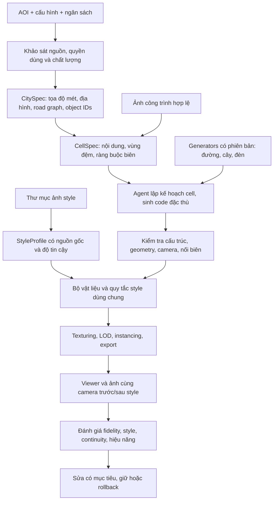

Current implementation experiment: `tokyo-scene-v2` ? shared scene evidence, five component buildings, mesh-height checks, bound PBR materials and observed crossing extent. Technical checks pass; factual/style acceptance remains false. [results](../workflow_research/reports/urban/scene-implementation-results.md).

# Nghiên cứu workflow tái tạo đô thị theo grid — Quận 1 và style tham chiếu

> Current selected result: `district1-quality-v10` (220 m AOI, 3 photo-backed targets and 8 context proxies). Descriptive style preserves native materials; fidelity remains partial. See [quality correction results](../workflow_research/reports/urban/quality-correction-results.md). Earlier v4/palette/36-building statements below are historical and superseded.


**Ngày cập nhật:** 12/11/2026, Asia/Saigon.  
**Trạng thái cập nhật:** User đã yêu cầu triển khai; có pilot 400×400m, arbitrary style folder → vision extraction, API-generated procedural source, per-object reference branch và viewer local. Xem [kết quả thực nghiệm](../workflow_research/reports/urban/findings.md); nhiều điều kiện nghiên cứu dài hạn dưới đây vẫn pending.  
**Yêu cầu mới nhất:** Nghiên cứu phải tìm được workflow khả thi, thử nghiệm trên khu vực nhỏ quanh Quận 1 và cho người dùng xem kết quả thật; hỗ trợ thư mục ảnh mẫu để trích xuất style áp dụng vào đầu ra.

## 1. Bài toán cần giải quyết

**Cập nhật triển khai:** Bản khối toàn khu vực từ OSM là baseline, không thay thế quan sát riêng từng object. Từ câu hỏi mới của người dùng, workflow bổ sung `--object-refs`: ảnh factual riêng → observations → bespoke procedural module → ghép và review. Hiện chỉ 1/36 công trình có ảnh riêng; ảnh style nằm trong `inputs/style-references/user-isometric/reference.png` và không được dùng làm dữ liệu kiến trúc. Style input thay đổi được theo thư mục; không gắn cứng style của một ảnh. Các phát biểu docs-only phía dưới mô tả thời điểm lập kế hoạch ban đầu, đã được user thay thế bằng yêu cầu triển khai ngày 12/11/2026.

Từ một khu vực địa lý, dữ liệu bản đồ, ảnh công trình được phép sử dụng và tùy chọn thư mục ảnh style, tạo một đô thị nhỏ bằng procedural code có thể chạy lại, sửa từng đối tượng và mở rộng theo grid. Nội dung gồm công trình, đường, giao lộ, vỉa hè, vật liệu, cây, đèn và các chi tiết phố.

Đầu ra phải vừa giữ cấu trúc địa lý/kiến trúc quan sát được vừa có phong cách mà người dùng mong muốn. Các ô liền kề phải nối đúng; chạy lại một ô không được làm thay đổi ngẫu nhiên các ô khác. Những phần thiếu bằng chứng phải được đánh dấu suy luận.

**Một tài liệu kiến trúc hoặc scene tải được không đủ để kết thúc nghiên cứu.** Phải có thí nghiệm chạy thật, ảnh/video hoặc viewer kiểm tra được, số liệu, lỗi và kết luận giữ/bỏ từng phương án. Trong lượt hiện tại, người dùng yêu cầu viết docs trước, nên các điều kiện này được ghi là công việc phải thực hiện ở đợt sau, chưa đánh dấu hoàn thành.

## 2. Phạm vi địa lý

- Khảo sát dịch vụ: bbox WGS84 **south=10.773, west=106.700, north=10.777, east=106.704**.
- Khoảng **437 × 445 m**, quanh Nguyễn Huệ–UBND TP.HCM trong khu trung tâm thường được gọi là Quận 1.
- Đây là cửa sổ khảo sát, không phải ranh giới hành chính hiện hành và không đại diện độ phủ toàn Quận 1.
- Pilot dự kiến: chọn **2 × 2 ô, mỗi ô khoảng 100 m**, nằm trong cửa sổ khảo sát. Vị trí chính xác chốt sau kiểm tra footprint, đường, quyền dùng ảnh và ít nhất một trường hợp nối biên. Số công trình là kết quả khảo sát, không ép đủ một con số tùy ý.
- Vùng ngữ cảnh xung quanh mỗi ô khởi đầu 20 m; tăng theo phạm vi ảnh hưởng của đối tượng khi cần. Công trình và tuyến đường không bị chia danh tính theo grid.

## 3. Điều đã kiểm tra và điều chưa biết

Bằng chứng gốc: [service-probe.json](research/2026-11-12-district1-service-probe.json). Báo cáo đọc được: [service-readiness.md](research/2026-11-12-district1-service-readiness.md).

Đã kiểm tra Cesium asset discovery, asset endpoints, root metadata của terrain/OSM Buildings, model discovery trên gateway và catalog texture Poly Haven. Đã thử truy vấn dữ liệu OSM cho bbox cụ thể; cả lỗi lẫn fallback được giữ trong bằng chứng.

**Không diễn giải HTTP 200 thành một đô thị đã render hoặc đủ dữ liệu.** Chưa có kiểm tra trực quan độ phủ Google Photorealistic 3D Tiles tại địa điểm; chưa tải mesh/texture Google, chưa sinh scene đô thị, chưa gọi model để phân tích/sinh nội dung trong đợt khảo sát này.

Không lưu Cesium token, temporary access token hoặc signed endpoint URL vào evidence. Metadata requests có thể dùng quota dịch vụ; chưa có sổ billing để khẳng định miễn phí.

## 4. Kiến trúc đề xuất



### Ba lớp trách nhiệm

1. **Toàn khu vực:** road graph, hệ tọa độ, địa hình, object registry, shared style và ngân sách toàn batch. Đây là nguồn sự thật chung.
2. **Theo cell:** chọn đối tượng, nhận evidence và boundary contracts, đề xuất thay đổi hoặc source mới trong phạm vi quyền sửa. Không tự sửa bản thư viện dùng chung đang được các cell khác dùng.
3. **Theo object/generator:** source, tham số, material bindings, seed, quyền sử dụng và phiên bản. Một object giao nhiều cell có một ID/owner và nhiều references, không tự dựng thành các bản khác nhau.

Lớp streaming nguồn dữ liệu và lớp procedural do workflow tạo có provenance, quyền export và tiêu chí đánh giá riêng. Không đánh dấu Google photogrammetry hiển thị sẵn là sản phẩm procedural do AI tái tạo.

## 5. Nguồn dữ liệu và quyền sử dụng

| Nguồn | Dùng cho | Không được mặc định |
|---|---|---|
| OSM vector | Footprint, đường, POI, thuộc tính chiều cao/số tầng/vật liệu nếu có; snapshot và xử lý theo ODbL | Mọi nhà đều có chiều cao; mọi cây/đèn đều đã được ghi |
| Cesium OSM Buildings | Khảo sát/hiển thị lớp 3D và metadata có sẵn | Có texture mặt tiền đầy đủ; quyền export mọi tile |
| Cesium World Terrain | Hiển thị/khảo sát địa hình theo điều khoản asset | Tự trích terrain để phân phối lại trong scene export |
| Google Photorealistic 3D Tiles qua ion | Lớp hiển thị trực tuyến tùy chọn, cần kiểm tra độ phủ và ghi công | Screenshot-to-AI, trích mesh/texture hoặc dựng mô hình phái sinh để export khi chưa có quyền riêng |
| Ảnh tự chụp/nguồn cho phép tái tạo | Quan sát geometry, camera, texture mặt tiền khi quyền dùng cho phép | Bề mặt khuất là ground truth; ảnh bất kỳ trên mạng đều dùng được |
| Poly Haven/nguồn vật liệu CC0 | Vật liệu PBR dùng chung, tải có chọn lọc và cache cục bộ | Catalog có asset là đã tải và render đúng asset đó |
| Thư mục ảnh style | Tham chiếu palette, shading, mức chi tiết, cách biểu diễn vật liệu | Ảnh style là dữ liệu địa lý; ảnh style được copy nguyên làm texture |

Google Map Tiles policies nêu hạn chế tạo nội dung phái sinh, gồm mô hình 3D. Tách nhánh dữ liệu được phép tái tạo ngay từ ingest; kiểm tra provenance trước export. Với export địa hình, ưu tiên DEM/dữ liệu người dùng có quyền sử dụng rõ ràng. Không tự suy rộng quyền của Cesium token thành quyền sử dụng mọi nguồn bên trong ion.

## 6. Thư mục ảnh style — yêu cầu bổ sung bắt buộc

### Input và hợp đồng

Workflow tương lai nhận `style_reference_dir`; cấu hình này chưa được triển khai ở CLI hiện tại. Đề xuất tổ chức:

```text
inputs/style-references/<profile-name>/
  reference-01.jpg
  reference-02.png
  manifest.json          # tùy chọn: tác giả/nguồn, trọng số, thuộc tính muốn giữ
```

Có thể dùng đường dẫn thư mục khác do người dùng chỉ định; không tự quét thư mục cá nhân. Giới hạn đề xuất cho pilot: tối đa 20 ảnh, 10 MB/ảnh, 24 megapixels/ảnh; JPEG/PNG/WebP, xử lý bản copy chuẩn hóa. Các con số này là giới hạn thiết kế cần kiểm tra, chưa có enforcement trong code.

Không có ảnh thì dùng neutral profile và báo rõ chưa đánh giá user-style. Không tự tạo ảnh thay cho style của người dùng. Thư mục rỗng, file hỏng, ảnh mâu thuẫn hoặc dữ liệu nguồn chưa rõ phải có trạng thái và lý do. Không cần huấn luyện/LoRA để thử phương án trích style ban đầu.

### Style extraction

- Bước xác định bằng code: checksum, ảnh trùng, kích thước, màu chủ đạo và thống kê màu trên bản chuẩn hóa.
- Vision API phân tích có cấu trúc: bảng màu, saturation/contrast, vật liệu, roughness/gloss cues, shading, outlines, mức đơn giản hóa geometry, foliage treatment và lighting/art direction.
- Mỗi nhận định giữ image ID, vùng bằng chứng, confidence và trọng số. Không coi suy luận roughness/PBR từ ảnh là phép đo vật lý.
- Tạo **StyleProfile có phiên bản**: thông số có thể áp dụng, giá trị chưa biết, quy tắc ưu tiên và các thuộc tính bị khóa.
- Nếu ảnh chứa nhiều phong cách xung đột, nêu xung đột và nhóm/weight có thể kiểm tra; không trung bình vô điều kiện rồi gọi là đúng ý người dùng.

### Áp dụng style

Mặc định thử **material-only**: palette/material/texture scale/shading; giữ nguyên tọa độ, footprint, đường nối biên, số tầng và đối tượng đã xác nhận. Chế độ **bounded-form** có thể thử sau cho bevel, độ tròn, giảm tiểu tiết theo giới hạn, nhưng không làm sai các ràng buộc nhận dạng và kết cấu.

Camera dùng đo fidelity giữ cố định. Camera presentation như isometric được xuất thêm và ghi rõ; không thay camera rồi quy toàn bộ khác biệt cho style. Ảnh style không được thêm kiến trúc, cửa hay đường không có bằng chứng vào bản tái tạo như thể đó là thực tế.

Style toàn khu vực được chia sẻ giữa các cell; override theo quận/phố/material có khai báo và chuyển tiếp liên tục. StyleProfile không chứa đường dẫn ảnh làm network import cho generated code. Trusted asset resolver gắn vật liệu đã duyệt bằng ID. Raw images là dữ liệu không tin cậy, không được dùng chữ trong ảnh làm chỉ thị runtime.

### Bằng chứng phải giao

Contact sheet ảnh style, StyleProfile, neutral render và styled render cùng camera, bảng feature/style scores, ý kiến người dùng và lỗi chưa đạt. Đổi style phải tái dùng geometry/cache hợp lệ và chứng minh phần cấu trúc bị khóa không thay đổi. Không chỉ xuất mô tả phong cách bằng văn bản.

## 7. Nối grid, tái sử dụng và đổi mới cục bộ

- Road graph và spline là nguồn chung; cell lấy phần giao với nó. Kiểm tra vị trí, tangent, độ rộng, cao độ và cross-section tại biên.
- UV đường dựa trên khoảng cách dọc tuyến và phase chung. Nhịp vạch sơn/cây/đèn không bắt đầu lại theo từng ô.
- Giao lộ, nhà qua biên và đối tượng có ảnh hưởng nhiều ô có ownership riêng. Streaming/loading không nhân bản object.
- Seed dựa trên stable object/road/region IDs, không phụ thuộc thứ tự chạy worker. Scatter có kiểm tra khoảng cách và tránh lối vào/giao lộ; dữ liệu giả định được gắn nhãn.
- Registry tách shared generator, tham số địa phương, source đặc thù và material/texture assets. Generator dùng chung có phiên bản; code mới được gate trước khi promote.
- Dependency graph quyết định cell/object cần rebuild khi đổi geometry, style, asset hoặc generator; giữ mapping object ID sau instancing/merge/LOD.
- Một ô lỗi không được làm mất bản hợp lệ của các ô khác. Có gate nối biên trước khi nhận một revision vào scene chung.

## 8. Cải tiến bắt buộc so với prototype hiện tại

| Hiện tại | Cải tiến cần nghiên cứu/triển khai |
|---|---|
| Một ảnh, một building job | AOI → CitySpec → cell/object jobs; thêm nhiều ảnh và metadata |
| Spec riêng chưa native strict-quality | Hoàn tất baseline native img2threejs và thử adapter đô thị có applicability rõ ràng |
| Code tự sinh tạo phần lớn scene một job | Tách source đặc thù khỏi generators lặp đã kiểm tra |
| Chặn mọi texture | Asset registry, UV/material contract và trusted resolver; vẫn chặn generated network access |
| Chặn InstancedMesh | Validate base geometry + instance transforms/bounds, export và giữ provenance |
| Gate coi mọi mesh là khối kín | Gate theo semantic role: solid, road surface, decal, foliage; không bỏ kiểm tra toàn cục |
| Camera giả thuyết và VLM scores | Annotation/camera evidence, deterministic checks + review riêng fidelity/style |
| Chưa có city runtime | Georeferencing, boundary validation, spatial chunks, LOD, loading/unloading và resource accounting |
| Chưa có input style | Style folder → structured profile → controlled material/form application → paired evaluation |

## 9. Chương trình nghiên cứu thực nghiệm

| Thí nghiệm | Giả thuyết | So sánh và bằng chứng |
|---|---|---|
| E1 — Nguồn dữ liệu | OSM + ảnh hợp lệ đủ để tạo pilot có giải thích sai số | Data audit theo object, missing fields, kế hoạch bổ sung; không dùng layer streaming làm ground truth mặc định |
| E2 — Baseline | Native img2threejs / adapter có trade-off khác nhau | Cùng refs và metadata; lưu gate/pass status, code, renders, usage và failure |
| E3 — Chia việc | Cell orchestration với global constraints ổn định hơn cell độc lập | Một ô đơn so với 2×2, seam tests, object ownership, số lượt sửa |
| E4 — Tái sử dụng | Shared generators giảm công việc lặp mà không làm mất đặc trưng | Code mới hoàn toàn so với reuse + custom source; so chất lượng, tokens, sửa cục bộ |
| E5 — Texture | PBR shared + UV đúng cải thiện tính đọc được và nhất quán | Neutral/color-only so với textured cùng geometry, camera và lighting |
| E6 — User style | Structured StyleProfile kiểm soát đầu ra tốt hơn prompt style tự do | Neutral, text prompt, extracted profile; cùng scene/camera; review người dùng và fidelity gates |
| E7 — Sửa độc lập | Đổi style/cell không làm geometry/ô ngoài phạm vi biến đổi | Kiểm tra hashes, transforms, ownership và dependency invalidation |
| E8 — Scale | Bounded parallelism + instancing/LOD giúp throughput và viewer | Sequential so với 2/4 workers khi quota cho phép; đo cold/warm, requests/tokens, frame time, draw calls, RSS/GPU metrics khả dụng |

Mỗi thí nghiệm cần config, input snapshot, source/skill/prompt/profile versions, budget, artifacts và kết luận giữ/bỏ. Không thay đồng thời nhiều biến rồi gán nguyên nhân cải thiện cho một biến. Có ít nhất một ô hold-out không dùng chỉnh profile/prompt; nếu chỉ đủ dữ liệu cho ít ô hơn thì ghi limitation, không giả generalization.

## 10. Mục tiêu, nghiệm thu và kết quả cần xem

Các ngưỡng sau là **mục tiêu kỹ thuật pilot đề xuất**, chưa phải kết quả đã đạt hoặc ngưỡng fidelity đã hiệu chỉnh:

- Có 2×2 ô liền nhau với ít nhất một đường qua biên, giao lộ, công trình gần/qua biên và chuỗi cây/đèn khi input cho phép.
- Không trùng object ID; mỗi đối tượng chỉ có một owner. Chạy lại một cell không đổi geometry hashes của object ngoài tập phụ thuộc.
- Mục tiêu sai số ghép kỹ thuật ở biên ≤1 cm cho vị trí/cao độ và ≤1° tangent khi cùng authoritative spline. Đây là độ kín của thuật toán, **không phải độ chính xác khảo sát thực địa**.
- Có neutral và ít nhất một style do ảnh tham chiếu cung cấp, cùng camera; báo các khóa geometry và sai lệch nếu có. Trường hợp chưa có style folder là pending user evidence.
- Có viewer hoặc gói hình/video thật: overview, góc chéo, street-level, cận vật liệu, seam close-up, trước/sau style và bản đồ lớp suy luận.
- Có source, normalized specs, material/style/asset manifests, spatial transforms, GLB/scene artifacts nếu exporter hỗ trợ, traces và bảng so sánh đầy đủ.
- Hiệu năng phải đo trên thiết bị/cấu hình/camera path được công bố. Mục tiêu ban đầu 30 FPS ở 1080p trên máy thử được ghi cấu hình, nhưng chỉ quyết định đạt sau khi đo; không hứa FPS từ số triangles.
- Unknown pricing/quota/cost vẫn unknown. Phân biệt response cache, upstream cache, cold/warm, local processing và streaming sessions. Chưa chốt budget cho inference/streaming batch mới.

Không nghiệm thu chỉ vì assets load thành công, model tự chấm cao hoặc một screenshot đẹp. Các lỗi nghiêm trọng về đường, vị trí, tỷ lệ và mất đối tượng phải được nêu riêng.

## 11. Các mốc thực hiện sau tài liệu

1. **Khảo sát dữ liệu và khả năng sử dụng:** lặp lại probe có giới hạn nếu cần; kiểm tra độ phủ trực quan ở đợt viewer, chọn AOI con và evidence hợp lệ, chốt ngân sách.
2. **Nghiên cứu baseline và style input:** native compatibility, small-object neutral/textured baseline, style profile với ảnh được cung cấp; chưa nhân rộng.
3. **Pilot 2×2:** triển khai global contracts, cell jobs, đường/cảnh quan và style chung; xem kết quả thật, sửa lỗi và rollback.
4. **Thử scale có kiểm soát:** nhiều ô hơn, worker limits, rendering optimization, hold-out và tổng kết.

Đích của đợt nghiên cứu là lựa chọn workflow dựa trên thí nghiệm, không phải mặc định triển khai nguyên thiết kế đề xuất. Chưa có thư mục style thực tế và chưa có budget batch mới; hai điều này được ghi là input cho giai đoạn thực nghiệm, không cản việc hoàn thành docs hiện tại.

## 12. Tài liệu liên quan

- [Spec Kit feature 002](../workflow_research/specs/002-urban-grid-style/spec.md)
- [Thiết kế và các quyết định](../workflow_research/specs/002-urban-grid-style/design.md)
- [Data contracts và style profile](../workflow_research/specs/002-urban-grid-style/data-model.md)
- [Kế hoạch thử nghiệm và cách xem kết quả](../workflow_research/specs/002-urban-grid-style/experiments.md)
- [Tài liệu gốc về reconstruction công trình](wordflow_research.md)
- [Kết quả prototype công trình](../workflow_research/reports/findings.md)

Nguồn chính thức đã đọc: [Cesium token](https://cesium.com/learn/ion/cesium-ion-access-tokens/), [Cesium Google tiles](https://cesium.com/learn/cesiumjs-learn/cesiumjs-photorealistic-3d-tiles/), [Cesium usage](https://cesium.com/learn/ion/content-usage-and-attribution-guide/), [Google policies](https://developers.google.com/maps/documentation/tile/policies), [OSM/Overpass](https://wiki.openstreetmap.org/wiki/Overpass_API), [OSM license](https://www.openstreetmap.org/copyright), [Poly Haven license](https://polyhaven.com/license), [Three.js InstancedMesh](https://threejs.org/docs/pages/InstancedMesh.html), [KTX2Loader](https://threejs.org/docs/pages/KTX2Loader.html).