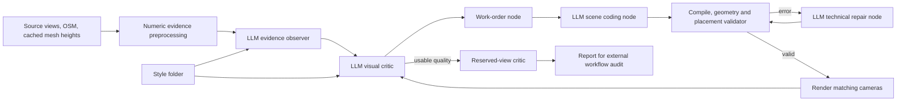

# Coordinated reconstruction nodes

The user clarified that the workflow must evaluate and improve its own outputs. The coding assistant develops and audits that workflow; it must not substitute its own building edits for the workflow's visual feedback loop.

## Diagnosis of the previous implementation

The earlier loop reviewed wide views, producing general instructions that did not reliably correct small but identifying roof and facade features. Style was passed as an image but not checked feature by feature. An observer also confused a high tower roof with a lower podium, and a downstream critic repeated that mistake. The critic's valid additional `shared_scene` section caused an overly narrow object-coverage validator to stop the run. An interrupted technical correction left an unreviewed program in the previous experiment. These are workflow defects, not evidence that a more expensive model is needed.

## Node responsibilities



1. Numeric evidence preprocessing loads existing source-surface samples, filters spatial interior points, records their source hashes and ground datum, and supplies representative XYZ anchors and height quantiles. Blue annotations mark source heights on source images. This is not a roof reconstruction or survey. It prevents unsupported level assignments such as moving an upper-roof feature to an imagined low podium. Edge contamination and hidden undercuts remain uncertain; new jobs need not require dense sampling.
2. The **observer node** examines the whole region, cached detail views, identity registration and actual style images. It produces stable feature IDs, owner IDs, view references, confidence and an explicit descriptive style contract. Materials/colors are observations per object, not a fixed style palette.
3. The **critic node** receives matching whole-scene pairs and detail pairs, the observer inventory, numerical evidence and style references. It checks every target feature and every style feature, with expected-versus-rendered evidence. Shared-scene checks are handled separately from the building coverage contract. Coder claims are not acceptance evidence.
4. The **work-order node** schedules the highest-impact critic issues, retaining stable IDs and the verification requirements. It routes actual feedback to the coding node instead of relying on human-authored patch instructions.
5. The **coding node** edits the joint AOI program and shared appearance/street controls. Tested optional tools for closed gabled roofs, hip roofs and polygon extrusions reduce repeated topology mistakes. No texture catalog or palette is compulsory. The coder must replace faulty structural geometry, not hide it under more ornaments or tint a wall cap as a roof.
6. The **technical validator/repair node** feeds actual compiler, manifold, placement and height failures back for one bounded code correction per attempt. A runtime success alone never establishes visual quality.
7. The critic checks the new render against the previous work order, including unresolved features and style. Improvement can be demonstrated by better scores or removal of stable blocking defects, without losing usable dimensions or introducing critical failures. Rejected candidates restore exact validated runtime checkpoints. Two stalled attempts stop spending instead of granting acceptance.
8. Reserved views are excluded from observation/coding prompts and evaluated at the end. The outer coding assistant inspects artifacts and improves these node interfaces and tools; it does not hand-edit city geometry to manufacture a passing result.

## Quality and cost boundaries

Approximate textures, inferred hidden details and modest simplification are acceptable. Each quality dimension must be >=3/5, mean >=3.5, and no major/critical defect may remain. A high-confidence identifying feature reported missing, or a style-contract feature reported missing, blocks optimistic acceptance even if the critic gives high aggregate scores. Model scores remain qualitative; acceptance is not surveyed accuracy.

All model nodes use GPT Sol through the configured base URL. The pilot allows at most three coding rounds, 14 HTTP attempts, 600k recorded/reserved tokens and 2700 active seconds. There are no automatic ambiguous transport retries. Actual usage and configured gateway rates determine dollar cost; unknown rates remain unknown. Observer/critic responses, images, work orders, coding responses, source snapshots, validator feedback, decisions and node timings are saved separately.

Static shadow maps are reused across camera-only changes and invalidated on lighting, geometry/visibility or vegetation changes. A controlled browser test compares cached versus live shadow pixels after lighting/visibility changes. This optimization changes render scheduling, not target geometry or material choice.

Initial-stage resume reuses an existing valid render only when the source hash, rendered city data, style profile and camera plan match. It is currently restricted to interruptions before the first work order. It preserves prior attempts and usage; later-round automated resume remains future work.

## Run

```powershell
$env:PYTHONPATH='src'
.venv/Scripts/python -m building_workflow.cli urban-workflow --run-id NEW_RUN --parent-run tokyo-scene-first-v2 --evidence-run tokyo-measured-v1 --repairs 3
```

The AOI and source filenames above are the reproducible experiment, not city-specific rendering logic. New jobs supply the same normalized city/source-view interfaces. `urban-scene` remains available for reproducing the previous experiment.
