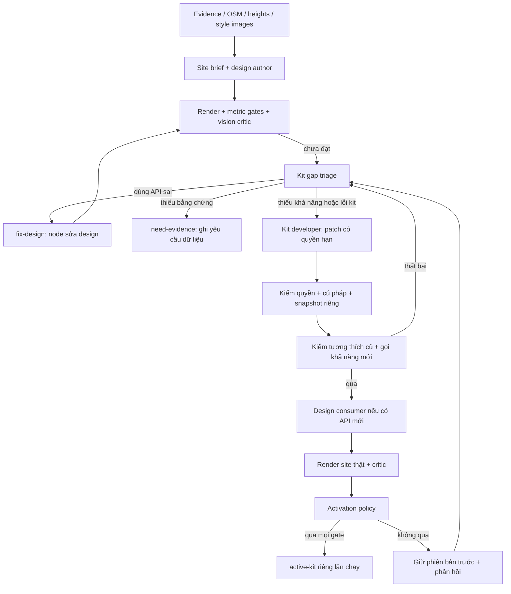

# Workflow tự phát triển kit: thiết kế, quyền hạn và kiểm chứng

## Phạm vi đã triển khai

Workflow có thể đề xuất và viết **code Three.js cho phiên bản kit riêng của lần chạy**, kiểm thử, render bằng trình duyệt, nhờ node critic đánh giá rồi quyết định giữ hay loại. Người vận hành cải thiện workflow và quan sát kết quả; phản hồi trực tiếp cho node viết code nằm trong workflow, không phụ thuộc việc người vận hành sửa tay từng mô hình.

Đường chạy chính vẫn là `design`: dữ liệu đo → site brief → trích xuất style → viết `design.mjs` bằng kit → render nhiều góc → kiểm tra hình học và critic → sửa có giới hạn. Đây không phải đường native img2threejs và chưa chứng minh chất lượng tương đương skill gốc. Nhánh tự phát triển kit nối sau vòng sửa design chưa được chấp nhận.

Các module thực thi:

- `src/worldscale/adaptive.py`: điều phối, ngân sách, phiên bản và chọn kết quả.
- `src/worldscale/kit_evolution.py`: phân loại thiếu sót, node developer, quyền sửa và chính sách kích hoạt.
- `src/worldscale/kit_regression.py`: kiểm thử trình duyệt độc lập trên nhiều footprint.
- `runtime/capabilities.json`: khả năng hiện có và còn thiếu; không coi một escape hatch custom mesh là một công cụ kiến trúc đã hoàn thiện.

## Luồng node



Luồng `adapt-kit` đã thực thi `fix-design` bằng node author → render → critic → giữ hoặc loại, trong số chu kỳ cho phép; bằng chứng thực tế trên công trình mới ở [docs/13](13-heldout-quality-and-scale.md). `need-evidence` vẫn ghi yêu cầu rồi dừng; chưa tự mua ảnh hoặc tìm provider mới. Trên lỗi patch/cú pháp/regression/render, các chu kỳ còn lại nhận chẩn đoán để thử lại trong ngân sách. Hết giới hạn thì giữ kết quả trước.

## Input cho từng vai trò

Design author nhận site đo trong hệ mét, footprint, cạnh và frame, eave/ridge/storeys, độ tin cậy, ảnh nhiều góc và crop chi tiết, style trích xuất cùng ảnh mẫu, API ngắn và phản hồi trước. API dùng footprint đo để dựng tường; không yêu cầu model tự đo lại tọa độ từ ảnh.

Qua thử nghiệm phát hiện brief cũ chỉ giữ length/width của cánh, bỏ centre/yaw. Brief mới giữ cả centre, yaw, corners hình chữ nhật và registration; thông tin cánh được dịch/nới theo cùng registration của mặt bằng. Khi đổi trục dài/ngắn phải đổi cả yaw, và giữ precision để không biến rectangle thành tứ giác lệch trong API có kiểm vuông góc. Đây vẫn là prior suy ra từ evidence, không phải đo đạc khảo sát. `adapt-kit` có thể phục hồi metadata này từ evidence và trace đăng ký của lượt cũ, ghi site mới riêng cho control/candidate; không sửa artifact nguồn.

Gap triage nhận lịch sử critic, metric, ảnh input/output, site, mục lục khả năng và một số source method liên quan. Nó phải phân biệt dữ liệu chưa rõ, sử dụng sai API, và API thực sự thiếu khả năng. Ví dụ mái L nhiều sống mái không được coi là đã hỗ trợ chỉ vì tồn tại hàm `roof` hoặc `add(customMesh)`.

Kit developer nhận yêu cầu cụ thể, source của tối đa ba method được cấp quyền, API, ảnh đối chiếu và danh sách helper sẵn có. Nó trả JSON gồm patch substring chính xác, method mới, ghi chú API và một `exercise` khai báo cách gọi tính năng mới. Nó không nhận `.env`, shell, công cụ phát hành hoặc toàn bộ source dự án. Source hình học dùng plan `[east,north]`; vertex render dùng `[east,up,south]`, phải đổi dấu trục north khi xuất Z.

Critic là node riêng, quan sát ảnh reference, render đúng camera, crop chi tiết hai phía, style và metric. Nó đưa điểm likeness/style/detail và yêu cầu sửa. Điểm model có nhiễu; việc được kích hoạt cục bộ không đồng nghĩa được người dùng chấp nhận.

## Quyền hạn thực tế

| Vai trò | Được thay đổi | Không được thay đổi |
|---|---|---|
| Design author | Cách phối hợp kit, tham số, vật liệu và chi tiết | Site gốc, footprint tường, camera đánh giá, quality gate |
| Gap triage | Đề nghị route và scope tối đa ba method trong allowlist | Tự cấp quyền ngoài allowlist hoặc tự phát hành |
| Kit developer | Bản sao riêng: `roof`, `roofY`, `gable`, `dormer`, `window`, `turret`, `chimney`, `material`; tối đa ba method mới | `walls`, constructor, frame/guard, wrapper, imports, file tùy ý, kit dùng chung |
| Regression/critic | Báo cáo kiểm tra và phản hồi | Sửa ngưỡng để candidate được qua |
| Activation policy | Con trỏ kit cục bộ sau khi qua gate | Release toàn cục, di trú asset cũ |

Code patch được đối chiếu với phần source bảo vệ, kiểm cú pháp bằng `node --check`, rồi chạy trong browser worker giới hạn thời gian và chặn request mạng. Đây là cơ chế kiểm soát code do model hợp tác sinh ra, **không phải sandbox chứng minh an toàn trước JavaScript thù địch**. Regex cấm một số khả năng không thay thế được phân tích AST hay cô lập hệ điều hành. Chưa cho node tự sửa gate hoặc các module phụ thuộc.

## Phiên bản và vòng đời

```text
runs/<run>/
  input-manifest.json                 # source/evidence/base/runtime hashes
  versions/base/                      # kit và dependency cố định đầu lượt
  baseline/                           # render lại control, critic thực tế
  cycle-N/
    triage.json / proposal.json / exercise.json
    runtime/                          # bản sao candidate, API notes
    syntax.json / permissions.json
    regressions/                      # API cũ trên ba footprint
    capability-regressions/           # bắt buộc gọi API/option mới
    render/                           # site thật nếu regression qua
    decision.json
  active-kit.json                     # chỉ có nếu có candidate được kích hoạt
  result.json / usage.json
```

Candidate không ghi đè kit nguồn. Mỗi lần đánh giá so sánh với control render lại bằng phiên bản base đã pin, thay vì lấy điểm của một kit cũ chưa rõ phiên bản. Khi có API hoặc option mới, node consumer cập nhật design để dùng nó; vì thế đây là so sánh kit + cách dùng, không phải A/B chỉ thay một biến. Sửa nội bộ tương thích cũ có thể khai báo `requires_design_update:false` để giữ nguyên design. Consumer nhận implementation API mới để hiểu điều kiện input; nếu gọi sai, nó có thêm tối đa một lần sửa theo lỗi runtime trước khi trả thất bại về nhánh kit. Không coi mọi lỗi caller là lý do viết lại library.

Manifest `active-kit.json` lưu đường dẫn, hash kit, hash từng dependency `.mjs`, chu kỳ và hash báo cáo quyết định. `--kit-version` kiểm hash trước khi sao chép sang lần chạy mới. Asset cũ tiếp tục pin bản cũ. Chưa có registry phát hành toàn cục, tự di trú asset hoặc tự thăng hạng candidate thành SDK ổn định.

## Điều kiện kích hoạt cục bộ

1. Tất cả kiểm thử phải chạy thật và qua; danh sách rỗng không được tính là qua.
2. Metric site thật phải qua; mean oblique IoU không giảm quá 0,025.
3. Likeness không giảm quá 0,02; style và detail không giảm quá 0,03.
4. Điểm thấp nhất trong ba chiều tăng ít nhất 0,03.
5. Kit không đổi trong khi kiểm tra; source kit dùng chung không đổi.

Các ngưỡng là chính sách thử nghiệm, chưa hiệu chỉnh trên nhiều kiến trúc. `accepted` cuối cùng còn yêu cầu mức quality chung của design; một cải thiện tương đối không tự trở thành kết quả hoàn thiện.

## Kiểm thử và cách sửa vòng phản hồi

Ba fixture là hình chữ nhật, footprint L và hình chữ nhật xoay; có chiều cao, số tầng và dạng mái khác nhau. Kiểm tra lỗi runtime/network, budget tam giác, chiều cao, tia ray đi qua lòng ống khói nhưng va thành ống, roof nằm trong footprint với dung sai và UV không suy biến. Cần hai nhóm: tương thích các lời gọi cũ và lời gọi khai báo của khả năng mới. Chạy nhóm cũ đơn lẻ không chứng minh code mới đúng. API có thể cần cánh mái do caller cung cấp: marker JSON `{"$fixture":"wing-corners"}` được harness thay bằng các polygon cánh tương ứng từng fixture. Đây là dữ liệu test tổng hợp, không phải tọa độ landmark hoặc code được model cho chạy tùy ý; kit không được phụ thuộc marker này.

Worker trả exit 2 khi một kiểm tra hoàn tất nhưng thất bại. Orchestrator vẫn phải đọc `result.json` để truyền lỗi từng fixture cho developer; không được biến nó thành lỗi worker rỗng. Lỗi JS trước khi viewer sẵn sàng cũng phải giữ `pageerror`, thay vì chỉ báo timeout. Test suite nguồn bảo vệ sự phân biệt này.

Các probe hiện tại chưa chứng minh roof kín nước, valley liên tục, mọi UV đúng tỷ lệ hoặc mọi attachment đúng. Cần bổ sung kiểm mặt cắt/ray roof sampling, self-intersection, tiếp giáp, vật liệu và benchmark kiến trúc trước khi release rộng. Critic cũng chưa được hiệu chỉnh với đánh giá nhiều người.

## Phân cấp để scale

Hướng thư mục ở [11-world-kit-structure.md](11-world-kit-structure.md) tách SDK hình học, domain kit, recipe theo họ, landmark, scene và runtime state. Đây là mục tiêu tổ chức; hiện thư viện building vẫn chủ yếu ở `runtime/kit.mjs`.

- SDK/core: metric frame, seed, geometry, UV, ownership; quyền sửa hạn chế, regression rộng.
- Domain: building/road/tree/...; developer chỉ nhận domain liên quan. Chưa triển khai đầy đủ các domain này.
- Family recipe: phối hợp công cụ, nhận footprint, kích thước, dữ liệu đo và seed. Chỉ được gọi là reusable family sau khi thử nhiều site thật.
- Landmark recipe: hình thái đặc trưng, provenance và giả định riêng; không đưa tọa độ landmark vào SDK.
- Scene/network: ID và graph đường/rail chung, stationing/UV liên tục, junction và ownership dùng chung qua grid. Không để mỗi ô tự đoán đường độc lập.
- Runtime: ngày/đêm, ánh sáng, ướt, gió, chuyển động tách khỏi footprint và topology cố định. Seed hình thái khác seed vị trí và trạng thái môi trường.

Dữ liệu mới trước tiên được đối chiếu registry và bằng chứng. Biến thể biểu đạt được thì sửa tham số/recipe; cấu trúc riêng thì giữ landmark/local helper; khả năng lặp lại mới đề xuất domain kit. Việc tự nâng cấp library dùng chung cần ma trận site giữ lại, kiểm tương thích, version API và chính sách rollback riêng; chưa tự động hóa bước đó.

Không nạp toàn bộ kit vào mọi prompt: author dùng API ngắn; triage dùng index và source liên quan; developer mới nhận source được sửa. Artifact và phiên bản pin theo hash. Chiết khấu prompt cache tùy provider, không được giả định có chỉ vì prompt lặp lại.

## Chiến lược cải tiến tiếp theo

1. Giữ đầy đủ dữ liệu hình học đã có trước khi tăng token: vị trí/góc cánh, registration, uncertainty và feature identity. Không buộc model tính lại rectangle chính xác từ OSM làm tròn. Không coi mọi blob photogrammetry là một dormer hoặc tháp đã xác nhận.
2. Thêm contract test riêng cho năng lực được đề xuất: sampling `roofY` so với ray trên mesh, kiểm gap/self-intersection/valley và UV theo mét. Test footprint hiện tại chỉ bắt được lỗi lớn, chưa chứng minh mái kín và junction đúng.
3. Phân biệt thiếu công cụ với chi tiết dùng chưa đúng. Critic v5 vẫn yêu cầu một window-surround kit dù API `window` đã có; triage phải đối chiếu source và cách dùng thực tế trước khi phát triển một bản trùng lặp. Điểm critic là dữ kiện để điều tra, không phải mệnh lệnh kỹ thuật luôn đúng.
4. Bổ sung đánh giá theo bộ phận và mức độ tin cậy. Chính sách hiện tại tăng điểm thấp nhất toàn công trình có thể loại một cải tiến mái hữu ích vì facade vẫn kém; cần benchmark trước khi thay chính sách, giữ nguyên báo cáo cũ và không đổi ngưỡng để hợp thức hóa một candidate vừa thất bại. Đánh giá component không được thay thế gate chất lượng toàn cảnh.
5. Dùng ma trận site giữ lại và biến thể tham số trước khi promote family/domain kit. Ba footprint tổng hợp chỉ là kiểm kỹ thuật; chưa chứng minh hiểu kiến trúc trên ba tòa nhà thật. Giữ landmark đặc trưng riêng và kiểm đường/rail qua cell khi mở rộng domain.

## Chạy và ngân sách

```powershell
.venv/Scripts/python -m worldscale.cli adapt-kit `
  --source-run runs/design-ichigokan-v2-quality `
  --run runs/new-kit-experiment --max-cycles 2 --max-tokens 220000

.venv/Scripts/python -m worldscale.cli design `
  --evidence inputs/evidence/tokyo-ichigokan-validated `
  --styles inputs/style-references/user-reference `
  --run runs/new-design --adaptive-kit --max-kit-cycles 1
```

Để dùng kit đã được kích hoạt, thêm `--kit-version runs/<run>/active-kit.json` vào lệnh `design`. Dùng tên run mới, không ghi đè chứng cứ cũ. Standalone giới hạn 1–3 chu kỳ, tối đa `3 + 5 * cycles` model call, ngân sách token và 2.400 giây provider; mỗi nhóm regression worker giới hạn 240 giây. Request lỗi mà billing chưa rõ không được tự retry vô hạn. Giới hạn token là quản trị request/usage, không phải cam kết trần hóa đơn gateway.

## Kết quả thực nghiệm

- `runs/kit-evolution-ichigokan-v1`: triage chọn `fix-design`. Sau khi kiểm tra, bổ sung lịch sử thất bại, registry và source thực tế cho triage để phân biệt thiếu API với dùng sai API.
- `runs/kit-evolution-ichigokan-v2`: developer tự tạo `roofWingGraph`, consumer dùng API và render thật. Critic từ 0,48/0,68/0,41 giảm xuống 0,38/0,44/0,32; metric cũng thất bại. Candidate bị loại, kit dùng chung không đổi. Quan sát ảnh xác nhận mái bị phản chiếu lệch khỏi tường. Kiểm tra bổ sung của người vận hành (`supervisor-capability-regressions`) phát hiện 25,47%/34,21% vertex mái vượt footprint ở hai fixture. Nhóm test mặc định trước đó đã qua vì không gọi nhánh mới: từ đây workflow bắt buộc test khả năng mới.
- `runs/kit-evolution-ichigokan-v3`: hai candidate đều bị chặn ở capability regression. Lời gọi thử dùng tọa độ cánh cố định; kiểm tra bổ sung giữ được lỗi JS `KIT_WING_ROOF_UNCOVERED_FOOTPRINT`. Orchestrator khi đó làm mất chẩn đoán vì exit 2, và developer chưa nhận trực tiếp patch bị loại. Hai lỗi phản hồi này đã được sửa; test nguồn bảo vệ việc truyền đủ patch và chẩn đoán sang developer. Kết quả v3 cũ vẫn giữ nguyên, không ghi lại như thể đã chạy bản sửa.
- `runs/kit-evolution-ichigokan-v4`: hai candidate vượt cả hai nhóm fixture, nhưng consumer truyền cánh không thật sự vuông góc trên footprint OSM. Hai render thật bị chặn bằng `KIT_INVALID_WING_RECTANGLE` / `KIT_WING_ROOF_RECTANGLE`. Từ phát hiện này, consumer được cung cấp source API mới và một lượt sửa lỗi caller có giới hạn. Không sửa artifact v4 để biến thất bại thành thành công.
- `runs/kit-evolution-ichigokan-v5`: node developer tạo code mới, cả sáu kiểm thử trình duyệt qua và consumer render được site thật. Critic 0,48/0,68/0,41 → 0,54/0,68/0,42; metric qua, nhưng gain điểm yếu nhất chỉ 0,01, dưới yêu cầu 0,03, nên **không kích hoạt**. Kiểm tra ảnh trực tiếp thấy mái không còn phản chiếu ra khỏi tường như v2; đầu hồi và mặt đứng vẫn đại trà, mái/texture còn đơn giản. 3 request thực tế + 2 cache hit, 44.160 token vào / 11.598 ra, billing chưa rõ bằng 0. Đây là bằng chứng luồng developer → test → consumer → render → critic → từ chối có thực thi, chưa phải chứng minh chất lượng đạt.
- `runs/kit-evolution-ichigokan-v6`: phục hồi đầy đủ centre/yaw/corners của cánh từ evidence và registration; consumer sử dụng trực tiếp `site.wings[].corners`. Developer tạo helper `_multiWingRoof` và mở rộng `roof`/`roofY`. Cả sáu fixture qua, metric site thật qua: mean oblique IoU 0,8889, plan IoU 0,9114, 27.861 tam giác. Critic 0,48/0,68/0,41 → **0,54/0,72/0,46**; gain điểm yếu nhất 0,05, mọi activation gate qua. Workflow tạo `active-kit.json`, kích hoạt **riêng lượt chạy**, shared runtime không đổi. Kiểm tra ảnh trực tiếp xác nhận mái bám bố cục cánh nhưng đầu hồi, facade và texture vẫn đơn giản; `accepted:false` toàn công trình được giữ nguyên. 4 request + 1 cache hit, 64.239 token vào / 9.931 ra; không có usage chưa rõ. Đã thực sự kiểm hash và sao chép kit từ manifest sang thư mục reuse riêng, không dùng điểm giả để chứng minh bước này. Chưa thử recipe trên tòa thứ hai.

v2 tốn 4 request thực tế + 1 cache hit, 60.951 token vào / 8.322 ra. v3 tốn 4 request + 1 cache hit, 68.849 vào / 15.340 ra. Không có request billing chưa rõ. `cost_usd` là null vì chưa có giá hợp đồng gateway; không suy diễn USD từ bảng giá provider khác. Cache ở đây là kết quả cục bộ, không phải token discount do provider.

Các lượt trên được giám sát để cải thiện workflow, không phải benchmark giữ nguyên mọi biến. Chỉ nghiệm thu chất lượng từ render và báo cáo thật; không lấy số test phần mềm làm bằng chứng hoàn thiện ngoại hình.

Kiểm thử tại mốc v6: 79 test qua, Ruff qua và `node --check` qua cho kit, surfaces, roof openings, viewer. Kết quả kiểm thử mở rộng sau đó ở docs/13. Test orchestration dùng critic giả chỉ xác minh caller repair, activation/rollback và manifest; điểm giả đó tuyệt đối không tính là nghiệm thu hình ảnh hoặc một candidate thật đã được kích hoạt.

Ảnh và báo cáo mẫu được lưu cùng docs để có thể xem ngoài thư mục run bị gitignore: [reference](results/kit-evolution/reference.jpg), [design giữ lại](results/kit-evolution/retained-design.jpg), [mái lệch bị loại v2](results/kit-evolution/rejected-offset-roof.jpg), [candidate v5 chưa được kích hoạt](results/kit-evolution/candidate-v5.jpg), [quyết định v5](results/kit-evolution/decision-v5.json), [critic v5](results/kit-evolution/review-v5.json).

Bản mới đã kích hoạt cục bộ: [ảnh v6](results/kit-evolution/candidate-v6.jpg), [quyết định v6](results/kit-evolution/decision-v6.json), [critic v6](results/kit-evolution/review-v6.json). Không được diễn giải các điểm số này là chất lượng đạt nghiệm thu của người dùng hoặc bằng chứng nhân rộng toàn đô thị.
