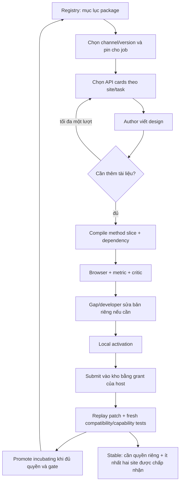

# Kho kit dùng chung, quyền phát hành và nạp ngữ cảnh chọn lọc

Cập nhật 2026-11-13. Đây là phần triển khai tiếp theo của docs/12–13. Kho chung đã có release building kit v6 ở kênh `incubating`; chưa có release `stable`. Việc lưu/phân phối code đã hoạt động, còn chất lượng ngoại hình của pilot vẫn chưa được nghiệm thu.

## Vòng đời đã triển khai



Model không nhận token phát hành và không có shell để sửa registry. Node developer trả patch; orchestrator kiểm quyền/gate rồi thực hiện thao tác kho. Cho phép phát hành không có nghĩa được bỏ qua kiểm thử, sửa policy hoặc đổi code core tùy ý.

## Nơi lưu và trách nhiệm

```text
workflow_scale_research/
  runtime/                         # source SDK gốc, tiếp tục được bảo vệ
  kit_library/
    registry.json                  # package index + channel pointers
    policy.json                    # gate incubating/stable
    releases/buildings/<hash>/     # release bất biến, source/API/dependency
      release.json                 # hash từng file, nguồn release
      context-index.json           # index tài liệu, không phải toàn bộ source
    events/<event>.json             # promotion/rollback audit; chỉ fingerprint grant
    submissions/<hash>/            # candidate đóng băng + fresh test reports
    grants/<id>.json                # quyền theo subject/package/action, có expiry/revoke
    workflow-profile.json          # cấu hình host: auto_publish + grant
  runs/<job>/kit-versions/base/     # snapshot pin tại thời điểm bắt đầu
  runs/<job>/attempt-N/
    selected-runtime/              # code render đã lược theo method dependency
  runs/<job>/kit-context/            # cards thực tế mà từng node nhận
```

Context log thực tế là `runs/<job>/kit-context/<node>.json`, không nằm trong mỗi attempt. Release và registry được lưu cùng Git. Grant/profile/submission có dữ liệu quyền hoặc đường dẫn máy nên không push; grant phải được cấp riêng trên môi trường mới. Release byte/hash được bảo toàn bằng `.gitattributes` để checkout Windows không đổi line ending của file đã hash.

`runtime/kit.mjs` không bị ghi đè khi phát hành. Khi registry tồn tại, job mới mặc định dùng release của default channel rồi pin vào thư mục job. Job đã pin và design có `--kit-version` không tự đổi sang release vừa phát hành. Không chạy migration asset cũ ngầm.

## Quyền và gate

| Action | Ai đang được cấu hình | Điều kiện |
|---|---|---|
| `submit` | `workflow`, scope `buildings` | Active manifest đúng hash, có local activation |
| `promote-incubating` | `workflow`, scope `buildings` | Patch hợp lệ với base trong kho; dependency bảo vệ không đổi; ít nhất ba fixture cũ và ba fixture tính năng mới chạy lại đều qua |
| `set-default` | `workflow`, scope `buildings` | Đi kèm promotion hợp lệ; chỉ ảnh hưởng job mới |
| `promote-stable` | Chưa cấp cho workflow | Gate trên + ít nhất hai object/site thật được chấp nhận với đúng candidate và artifact render kiểm hash |
| `rollback` | Quyền vận hành riêng, chưa cấp tự động cho workflow | Phiên bản đã tồn tại trên channel; incubating có thể quay về builtin |

Grant host hiện được cấp 30 ngày. Có thể thu hồi ngay, cấp lại với thời hạn khác hoặc dùng `--no-publish-kit` cho một job. Model không tự gia hạn quyền. Quyền là cơ chế điều phối trong một workspace tin cậy, **không phải IAM đa người dùng hoặc sandbox chống kẻ có quyền sửa filesystem**. Một người/process có toàn quyền trên máy vẫn có thể sửa file; cần dịch vụ ký release và storage phân quyền nếu triển khai đa tenant.

Promotion giữ lock kho, kiểm checksum submission/validation/policy và so sánh channel head. Hai job phát triển từ cùng base không được ghi đè nhau: candidate thứ hai nhận lỗi yêu cầu rebase nếu head đã đổi. Release cũ không xóa; rollback đổi con trỏ channel, không sửa source release. Việc copy file release và cập nhật pointer chưa là database transaction phân tán; release bị gián đoạn trước khi index được cập nhật có thể cần operator dọn bản chưa hoàn tất.

Stable không dựa vào `accepted:true` do model tự khai báo. Gate đọc metric/review, đúng kit pin, master hash của runtime slice, browser report và bundle hash của run; kiểm lại artifact khi promote. Các kiểm tra này vẫn dựa vào artifact trong workspace tin cậy, chưa phải chứng thực từ worker máy khác. Một release `incubating` có thể cải thiện tương đối nhưng chưa đạt chất lượng toàn công trình.

## Nạp chọn lọc ở ba tầng

1. **Package discovery:** `Library.search(query, limit)` đọc registry nhỏ và trả tối đa 12 mô tả package; không mở source tất cả release. Hiện có một package thật là `buildings`.
2. **Ngữ cảnh model:** `kit_context.context` chia API thành `core`, `materials`, `shell`, `roofs`, `facades`, `details`, `geometry` và extension cards. Chọn theo site, method đã dùng, feedback và yêu cầu explicit. Ngân sách tối đa 16.000 ký tự tài liệu, tối đa tám cards được chọn tự động và index tối đa 12 mục. Đây là giới hạn ký tự, không phải token model hoặc tổng prompt. Site, ảnh và phản hồi vẫn có chi phí riêng.
3. **Runtime:** `runtime_slice` lấy các method được script gọi và closure helper `this.method(...)`, luôn giữ constructor/walls/finish và guard. Dependency tương đối cần thiết được copy; esbuild bundle phần source này cho render. Master release luôn lưu đủ code để node developer/release validator dùng, không lấy bản slice làm base phát triển tiếp.

Author có thể trả `{"request_kit_docs":["details"]}` thay vì đoán API. Orchestrator chỉ cho lấy tối đa ba ID đã tồn tại và thêm một lượt model, cùng ngân sách token/thời gian. Không có yêu cầu path tùy ý hoặc đọc `.env`. Nếu vẫn thiếu thì fail để vòng sửa xử lý, không nạp toàn bộ kho làm fallback.

Node developer chỉ nhận method được cấp quyền, API liên quan và test diagnostics. Triage nhận source liên quan cùng extension helper hiện có để không phát triển lại một khả năng đã có. Helper mới reachable từ method domain đã được phép cũng có thể được cấp quyền sửa ở chu kỳ sau; các helper core như `_add`, `_loft`, frame/guard vẫn được bảo vệ.

Giới hạn hiện tại: source vẫn là class building kit, chưa tách vật lý thành road/tree/rail modules. Slicing dùng hợp đồng lời gọi tĩnh và regex, không phải JavaScript AST compiler tổng quát. Script nên dùng `b.method(...)` hoặc `b['method'](...)` với tên literal; alias/dispatch động có thể bị thiếu method và bị runtime chặn. Hàm top-level/dependency có dùng chung vẫn có thể xuất hiện trong bundle; không tuyên bố loại hết mọi byte không dùng. Registry/package API mở đường cho domain mới nhưng chưa tự bootstrap hay tự ghép release đa domain.

## Thực nghiệm thật trong lần triển khai này

- Candidate v6 đã được submit vào kho, replay patch từ base builtin, kiểm dependency và **chạy lại sáu browser fixtures**, đều qua.
- Đủ điều kiện `incubating`, không đủ `stable`; được promote vào release `23e3caa2e538a88edb5602edd3315f779baf97535a63e2ce3a5f122895f9f06e`. Default channel được chuyển sang `incubating`.
- Job render mới không truyền `--kit-version` đã lấy release từ registry qua cùng hàm snapshot mà workflow design dùng. Pin và render qua runtime slice thành công: **27.861 tam giác**, mean oblique IoU **0,8889**, plan IoU **0,9114**, khớp v6 trước slicing. Đây là chạy lại code v6 đã lưu, không phải gọi model viết một bản mới.
- Source kit master 35.789 ký tự, slice 33.460 ký tự; bỏ chín method không dùng. Cảnh museum sử dụng phần lớn kit nên mức giảm source chỉ khoảng 6,5%, không thổi phồng hiệu quả.
- API context ví dụ cho office: bảy cards, 5.520 ký tự; không có card `details` ở lượt đầu. Kiểm thử thêm 300 extension không liên quan xác nhận không chèn toàn bộ vào prompt. Kiểm thử author xác minh có thể yêu cầu card còn thiếu trong một lượt bổ sung; đây là test provider giả, không tính như lượt model thực tế.
- Đã trực tiếp xem [ảnh render lấy từ kho chung](results/shared-kit-library/render.jpg). Kết quả vẫn có các điểm yếu ngoại hình v6; không có critic mới và không tuyên bố nâng chất lượng chỉ vì phát hành vào kho.
- Đã thực thi rollback kho thật về builtin rồi khôi phục incubating: hash của job đã pin không đổi. Quyền operator dùng để thử rollback đã thu hồi sau kiểm tra. [Báo cáo rollback](results/shared-kit-library/rollback-check.json).

Chứng cứ: [fresh regression summary](results/shared-kit-library/validation-summary.json), [promotion](results/shared-kit-library/promotion.json), [runtime selection](results/shared-kit-library/runtime-selection.json), [context selection](results/shared-kit-library/context-selection.json), [metric](results/shared-kit-library/metrics.json).

Kiểm thử phần mềm: 94 test qua ở mốc triển khai này, bao gồm grant hết hạn/thu hồi, sai scope, stable gate không thể bỏ qua bằng quyền, submission/release bị sửa, stale channel head, pin/rollback, context có hàng trăm extension và dependency closure. Các test dùng provider/regression giả chỉ xác minh điều phối; kết quả sáu fixture thật và browser render ở trên được lưu riêng, không thay bằng điểm giả.

## Lệnh vận hành

```powershell
# Xem kho, tìm package
.venv/Scripts/python -m worldscale.cli kit-library status
.venv/Scripts/python -m worldscale.cli kit-library search --query "building roof"

# Trên máy mới: operator cấp quyền và cấu hình profile workflow
.venv/Scripts/python -m worldscale.cli kit-library grant --subject workflow --package buildings --actions submit promote-incubating set-default --hours 720 --configure-workflow

# Workflow tự publish sau local activation, theo profile host
.venv/Scripts/python -m worldscale.cli design --evidence inputs/evidence/tokyo-ichigokan-validated --styles inputs/style-references/user-reference --run runs/new-library-job --adaptive-kit

# Một job chỉ thử cục bộ, không publish
.venv/Scripts/python -m worldscale.cli adapt-kit --source-run runs/source --run runs/local-only --no-publish-kit

# Các thao tác riêng: submit → validate → promote
.venv/Scripts/python -m worldscale.cli kit-library submit --manifest runs/candidate/active-kit.json --token <host-grant>
.venv/Scripts/python -m worldscale.cli kit-library validate --submission <submission-id>
.venv/Scripts/python -m worldscale.cli kit-library promote --submission <submission-id> --channel incubating --token <host-grant> --set-default

# Cần grant có action rollback và subject khớp
.venv/Scripts/python -m worldscale.cli kit-library rollback --channel incubating --version <previous-version> --token <rollback-grant> --subject operator
.venv/Scripts/python -m worldscale.cli kit-library revoke --token <grant-to-revoke>
```

Không ghi grant vào prompt, PR hoặc Git. CLI cấp quyền chỉ dùng bởi host/operator; node coding không có tool gọi nó. Máy hiện tại đã có profile auto-publish scope building, không cần cấp lại để tiếp tục chạy. Máy clone repo chỉ dùng release đã lưu; muốn auto-publish phải được cấp grant mới.

## Việc còn lại

Hoàn thiện multi-domain packaging/selection, catalog search theo semantic capability khi kho lớn, AST module extraction, migration recipe có kiểm tra và kiểm benchmark độc lập trước stable. Tiếp tục cải thiện topology/facade/texture và quality evaluation; cơ chế kho không tự khắc phục mô hình kém. Quy mô đô thị, streaming/LOD, network seams và đa thành phố vẫn theo các task chưa hoàn tất ở SpecKit.
